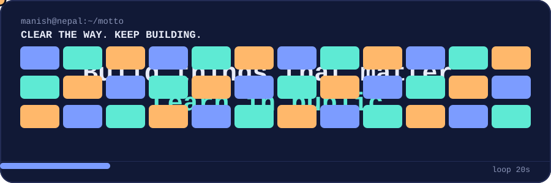
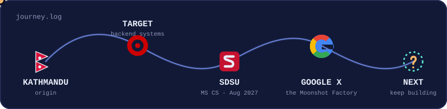

  <picture>
    <source media="(prefers-color-scheme: dark)" srcset="./assets/header.svg">
    <source media="(prefers-color-scheme: light)" srcset="./assets/header.svg">
    
  </picture>

  <picture>
    <source media="(prefers-color-scheme: dark)" srcset="./assets/typing.svg">
    <source media="(prefers-color-scheme: light)" srcset="./assets/typing.svg">
    
  </picture>

  
  
  

I’m **Manish** — a software engineer from Nepal, now based in San Diego. I spent about 3.5 years building Java backend systems for enterprise carts and checkout at Target, later interned at X, the Moonshot Factory, and I’m now completing my M.S. in Computer Science at San Diego State University (August 2027).

I like distributed systems, intelligent tools, and explaining what I learn at [engineerfromnepal.com](https://engineerfromnepal.com).

## Journey

  <picture>
    <source media="(prefers-color-scheme: dark)" srcset="./assets/journey.svg">
    <source media="(prefers-color-scheme: light)" srcset="./assets/journey.svg">
    
  </picture>

## Stack

  
  
  
  
  
  
  
  

  <code>distributed systems</code> · <code>event-driven architecture</code> · <code>RAG</code> · <code>observability</code>

## Selected work

<table>
  <tr>
    <td valign="top">
      <h3>🌐 <a href="https://github.com/Thapamanish/engineerfromnepal">Engineer From Nepal</a></h3>
      
A publication and tool shelf for practical engineering work.

      
<code>web</code> <code>writing</code> <code>tools</code>

    </td>
  </tr>
  <tr>
    <td valign="top">
      <h3>🧠 <a href="https://github.com/Thapamanish/breakout-dqn">Breakout DQN</a></h3>
      
Learning reinforcement learning by building the pieces.

      
<code>Python</code> <code>PyTorch</code> <code>RL</code>

    </td>
  </tr>
  <tr>
    <td valign="top">
      <h3>⌁ <a href="https://github.com/Thapamanish/neetcode-submissions">NeetCode</a></h3>
      
A living notebook for algorithms and problem solving.

      
<code>DSA</code> <code>practice</code> <code>patterns</code>

    </td>
  </tr>
</table>

## Contributions

  <picture>
    <source media="(prefers-color-scheme: dark)" srcset="https://raw.githubusercontent.com/Thapamanish/Thapamanish/output/github-contribution-grid-snake-dark.svg">
    <source media="(prefers-color-scheme: light)" srcset="https://raw.githubusercontent.com/Thapamanish/Thapamanish/output/github-contribution-grid-snake.svg">
    
  </picture>

  <a href="https://engineerfromnepal.com">Read the blog</a> ·
  <a href="https://www.linkedin.com/in/iammanish041/">LinkedIn</a> ·
  <a href="mailto:your.email@example.com">Email</a>

origin: Nepal · current: San Diego · status: building

